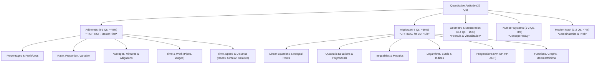
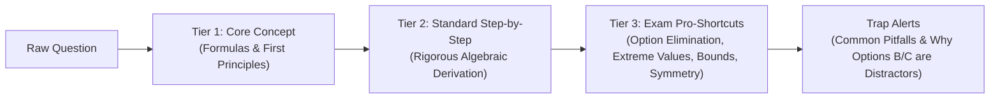
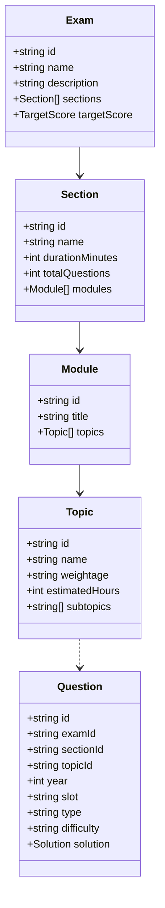

# CAT Master Preparation Blueprint & Resource Architecture

A strategic, multi-phase framework designed for **CAT (Common Admission Test)** and architected for seamless extension to other competitive aptitude examinations (**XAT, GMAT, GRE, GATE**).

---

## 1. CAT Examination Structure & Scoring Blueprint

| Section | Questions | Time Limit | Question Types | Marking Scheme | 99th Percentile Target Score (Approx) |
| :--- | :--- | :--- | :--- | :--- | :--- |
| **VARC** (Verbal Ability & Reading Comprehension) | 24 | 40 mins | 16 RC, 8 VA | +3 for correct, -1 for wrong MCQ, 0 for TITA | ~38 - 42 marks (~14 net correct) |
| **DILR** (Data Interpretation & Logical Reasoning) | 20-22 | 40 mins | 4-5 Sets (4-5 Qs/set) | +3 for correct, -1 for wrong MCQ, 0 for TITA | ~28 - 32 marks (2 to 2.5 full sets) |
| **QA** (Quantitative Aptitude) | 22 | 40 mins | Arithmetic, Algebra, Geom, Numbers, Modern | +3 for correct, -1 for wrong MCQ, 0 for TITA | ~32 - 36 marks (~11-12 net correct) |
| **Total** | **66** | **120 mins** | **~48 MCQ, ~18 TITA** | **Max Marks: 198** | **Overall 99%ile: ~85 - 95 marks (~45-50% raw score)** |

> [!IMPORTANT]
> **Key CAT Insight**: CAT is an exam of **selection**, not completion. Achieving a 99th percentile does **not** require attempting 100% of the paper; it requires scoring ~45% to 50% net marks with high accuracy (85%+).

---

## 2. Exhaustive Syllabus & High-Yield Weightage Matrix

### Section A: Quantitative Aptitude (QA)
QA questions follow a Pareto distribution: ~70% of the questions consistently emerge from **Arithmetic** and **Algebra**.

### Section B: Data Interpretation & Logical Reasoning (DILR)
Since 2020, CAT DILR has shifted from traditional standard bar charts to **unconventional, puzzle-based reasoning and hybrid quant-reasoning sets**.

1. **Logical Reasoning (Core)**:
   - Complex Seating Arrangements (Linear, Circular, Bi-directional)
   - Matrix Matchings (Multi-variable assignments)
   - Games & Tournaments (Round-Robin, Knockout, Seeding, Margin of Victory)
   - Truth-Liar Binary Logic (Alternators, Knights & Knaves)
   - Routes, Networks & Bottlenecks
   - Cubes, Cuts & Colored Faces
2. **Data Interpretation & Hybrid Quant-DI**:
   - Missing Value Tables & Constraints
   - Venn Diagrams (3-Set and 4-Set Maxima-Minima optimization)
   - Caselets with algebraic constraints
   - Scatter plots, Cumulative Frequency, Bubble charts

### Section C: Verbal Ability & Reading Comprehension (VARC)
1. **Reading Comprehension (16 Questions, 4 Passages $\times$ 4 Qs)**:
   - Passages sourced from Aeon Essays, The Guardian, The Atlantic, Smithsonian, Project Syndicate.
   - Domains: Philosophy & Ethics, Sociology & Anthropology, Science & Technology, Economics & History.
   - Question Types: Primary Purpose, Inference, Central Argument, Author's Tone, Paradox/Flaw Identification.
2. **Verbal Ability (8 Questions)**:
   - Para Jumbles (4 sentences, TITA/MCQ)
   - Para Summary (Extracting the core argument without distortion)
   - Para Completion (Selecting the logically succeeding closing sentence)
   - Odd Sentence Out (Pinpointing the contextual outlier)

---

## 3. High-Quality Previous Year Question (PYQ) Sources

| Resource Name | Coverage | Access Model | Best Used For |
| :--- | :--- | :--- | :--- |
| **IIM Official CAT Past Papers** | 2017 – 2024 (Slots 1, 2, 3) | Free / Public Domain | Authentic exam interface feel and official answer keys |
| **2IIM Question Bank** | 2017 – 2024 slot-wise | Free (No login required) | Detailed video solutions + alternative algebraic shortcuts |
| **Cracku Daily Target & Past Papers** | CAT 2000 – 2024 | Free past papers with solutions | Section-wise & topic-wise filtered practice |
| **Bodhee Prep** | VARC special focus | Free articles & solved RCs | Passage breakdown and tone analysis |
| **Takshzila / Elites Grid** | DILR & Quant playlists | Free YouTube archives | Unconventional DILR sets and algebraic shortcut techniques |

---

## 4. Problem-Solving Methodology: "How to Solve" Framework

To maximize score per minute, solutions must adhere to the **3-Tier Analysis Model**:

1. **Option Elimination**: Test options against boundary conditions (e.g., $n=1$, $x=0$, parity, divisibility checks).
2. **Scale / Extreme Values**: Substitute simple whole numbers that satisfy constraints.
3. **Geometric Visualization**: Draw accurately scaled diagrams; often symmetry reveals angles and lengths without cumbersome trigonometric expansion.
4. **DILR Anchor Method**: Identify the one fixed constraint in a puzzle (e.g., "Person X never sits next to Y") and branch into at most 2 candidate cases.

---

## 5. Daily Tracker: Metrics That Drive a 99th Percentile

A high-yield daily tracker balances **Volume**, **Accuracy**, and **Syllabus Velocity**:

$$\text{Daily Velocity} = \text{Questions Solved} \times \text{Accuracy Rate (\%)} - \text{Penalty for Unanalyzed Errors}$$

### Recommended Daily Target:
- **Questions**: 25 – 35 questions/day (or 1 full DILR set + 2 RCs + 15 Quant questions).
- **Time Commitment**: 2.5 to 3.5 hours on weekdays; 5 hours on weekends.
- **Accuracy Benchmark**: $> 80\%$ on untimed practice; $> 65\%$ on timed mocks.
- **Error Notebook Rule**: Every wrong question must have a logged root cause (*Calculation Error*, *Concept Missing*, *Misread Question*, *Time Pressure*).

---

## 6. Multi-Exam Architecture (Extensibility Roadmap)

The data model is schema-driven to accommodate any competitive examination:

- **XAT Module**: Add *Decision Making* (DM) ethical cases and Critical Reasoning.
- **GMAT Focus Module**: Add *Data Insights* (Multi-Source, Data Sufficiency, Table Analysis).
- **GRE / GATE**: Add specialized technical modules and analytical writing without altering application code.

---

## 7. Sprint Roadmaps & Countdown Blueprints (3M / 1M / 1W)

For detailed, research-backed countdown execution strategies across various time horizons before exam day, refer to the master sprint guide:

👉 **[CAT Master Sprint Plans Guide (3-Month, 1-Month & 1-Week Blueprints)](file:///d:/Dev/CatPrep/CAT_SPRINT_PLANS.md)**

### Key Countdown Horizons:
1. **3-Month Master Sprint (90 Days / ~400 Hours)**: High-ROI concept dominance (Arithmetic + Algebra), 2017–2024 authentic DILR set consolidation, and 15–20 full mocks with 1:2 test-to-analysis forensic autopsies.
2. **1-Month Lockdown Sprint (30 Days)**: Peak execution, 2 slot-timed mocks/week, 5-minute DILR set selection rule, ABC question triage, zero new chapters, and confidence preservation.
3. **1-Week Countdown Protocol (D-7 to D-Day)**: Baseline mock on D-7, error log purge, formula flashcards, logistics clearance (admit card + original ID), complete study shutdown on D-1, and 120-minute exam hall execution playbook.
4. **Curated Free Internet Directory**: Direct links to top free channels and portals: **Rodha** (concept video theory), **Cracku** (free mocks & daily targets), **2IIM** (free authentic past paper solutions), **Elites Grid** (DILR puzzle mastery), **Takshzila** (free fundabooks), **Bodhee Prep / Gejo Speaks** (VARC), and the **Official IIM Mock Simulator**.

