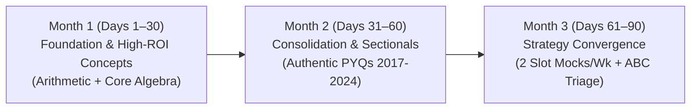
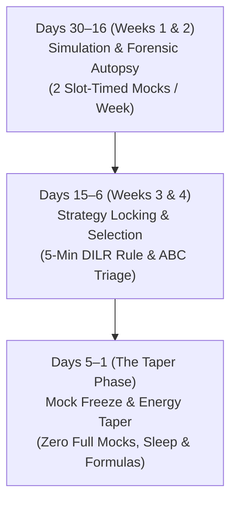

# CAT Countdown & Sprint Roadmaps: 3-Month, 1-Month & 1-Week Master Blueprints

A comprehensive, research-backed strategy framework synthesizing the methodologies of 99+ percentilers and premier CAT prep institutes (**IMS, 2IIM, Cracku, Rodha, Takshzila, and Elites Grid**).

---

## 1. Executive Strategy & Time-Horizon Matrix

| Horizon | Primary Focus | Study Volume | Mock Cadence | Core Rule / Philosophy |
| :--- | :--- | :--- | :--- | :--- |
| **3 Months** (90 Days) | Foundation $\rightarrow$ Authentic PYQs $\rightarrow$ Strategy Convergence | ~400 Hours total (3.5h weekdays / 7-8h weekends) | 15 – 20 Full Mocks (1/wk in M2, 2/wk in M3) | **Pareto 70/30 Rule**: Master Arithmetic & Algebra, anchor DILR puzzle types, read diverse essays daily. |
| **1 Month** (30 Days) | Strict Execution, Forensic Autopsy & Question Selection | ~120 Hours total (4-5h daily) | 6 – 8 Full Mocks (tapering in final 5 days) | **Zero New Theory**: Your score rises by skipping time traps, not by cramming obscure theorems. |
| **1 Week** (D-7 to D-Day) | Composure, Circadian Rhythm, Formulas & Logistics | ~20 Hours total (tapering to 0 on D-1) | 1 Baseline Mock on D-7; **Zero** thereafter | **Neural Conservation**: Protect confidence and sleep. 40-minute compartmentalization on D-Day. |

---

## 2. The 3-Month Master Sprint (90 Days / ~400 Hours)

### Core Philosophy
CAT is an exam of **selection**, not completion. A raw score of ~45–50% (~85–92 marks out of 198) consistently yields a **99th percentile**. Trying to study 100% of every topic leads to superficial knowledge and time traps. Focus on **depth and accuracy in high-ROI areas**.

---

### Phase 1: Month 1 (Days 1–30) — High-ROI Foundations
* **Target Hours**: ~32 hours/week (3.5h on weekdays, 7h on weekends).
* **Mock Cadence**: 1 Diagnostic Mock on Day 1 + 1 Mock every 10 days.

#### Section-by-Section Plan:
1. **Quantitative Aptitude (QA)**:
   - **Week 1-2 (Arithmetic Core)**: Percentages, Profit & Loss, Simple & Compound Interest, Ratios & Proportions, Averages, Mixtures & Alligations.
   - **Week 3-4 (Time, Speed, Distance & Work + Algebra Intro)**: Time & Work (Pipes & Cisterns), TSD (Relative speed, Races), Linear & Quadratic Equations, Logarithms.
   - *Daily Volume*: 20–25 questions with alternative shortcut exploration.
2. **Data Interpretation & Logical Reasoning (DILR)**:
   - **Week 1-2**: Linear & Circular Arrangements, Multi-variable Matrix Matchings.
   - **Week 3-4**: Games & Tournaments (Knockout brackets, Round-Robin point systems), Missing Value Tables.
   - *Daily Volume*: 2 sets daily (1 LR + 1 DI).
3. **Verbal Ability & Reading Comprehension (VARC)**:
   - **Daily Reading**: 2 long-form articles (Aeon Essays, The Guardian Long Reads, Smithsonian).
   - **Verbal Ability**: TITA Para Jumbles (pronoun/noun mandatory pairs) & Para Summaries.
   - *Daily Volume*: 2 RCs + 5 VA questions.

#### Checkpoints & Deliverables:
- [ ] Take official CAT 2023 Slot 1 as a Diagnostic Mock to identify blind spots.
- [ ] Complete Arithmetic mastery (minimum 150 solved questions across all 6 subtopics).
- [ ] Solve 40 DILR foundation sets across Arrangements, Matrix Matchings, and Tournaments.
- [ ] Log every mistake in the **Mistake Notebook** with root causes (*Concept*, *Calculation*, *Trap Choice*, *Time Panic*).

---

### Phase 2: Month 2 (Days 31–60) — Consolidation & Authentic PYQs
* **Target Hours**: ~35 hours/week.
* **Mock Cadence**: 1 Full-Length Mock every weekend + 2 mid-week sectional tests.

#### Section-by-Section Plan:
1. **Quantitative Aptitude (QA)**:
   - **Week 5-6**: Advanced Algebra (Inequalities, Modulus, Functions, Graphs, Maxima/Minima, Progressions AP/GP/AGP).
   - **Week 7-8**: High-Yield Geometry (Triangles, Circles, Mensuration) + Modern Math foundations (Permutations & Combinations basic constraints).
   - *Daily Volume*: 20 PYQs with a strict 2-minute timer per question.
2. **Data Interpretation & Logical Reasoning (DILR)**:
   - Solve authentic CAT 2017–2024 DILR sets (available on 2IIM and Cracku repositories).
   - Focus on unconventional sets: Routes & Networks, Optimization, 4-Set Venn Diagrams (Maxima-Minima).
   - *Daily Volume*: 3 authentic CAT DILR sets daily.
3. **Verbal Ability & Reading Comprehension (VARC)**:
   - Target difficult genres: Philosophy, Sociology, Anthropology, and Art History.
   - Option Elimination Drills: Pinpoint distractor types (*Out of Scope*, *Extreme/Distorted*, *Half-True*, *Opposite*).
   - *Daily Volume*: 3 timed RCs (10 mins/passage) + 6 VA questions.

#### The 1:2 Mock Autopsy Protocol:
For every 2-hour mock, allocate **4 full hours** of forensic analysis:
1. **Unattempted Questions**: Solve without timer. If solvable in < 3 minutes, note why it was skipped.
2. **Incorrect Questions**: Categorize whether it was a calculation slip, misreading, or concept deficit.
3. **Correct Questions**: Check if the author or top percentiler used a faster shortcut or option-elimination trick.

---

### Phase 3: Month 3 (Days 61–90) — Exam Mode & Strategy Convergence
* **Target Hours**: ~35 hours/week.
* **Mock Cadence**: 2 Full-Length Mocks per week strictly aligned with assigned CAT slot time.

#### Strategic Principles:
1. **The ABC Question Triage**:
   - **Round 1 (Bucket A - 0 to 15m)**: Instant sitters solvable in < 90 seconds.
   - **Round 2 (Bucket B - 15 to 32m)**: Solvable multi-step problems (2 to 2.5 minutes).
   - **Round 3 (Bucket C - 32 to 40m)**: Boundary value testing, TITA guesses, or deliberate skipping.
2. **DILR 5-Minute Selection Rule**:
   - Spend minutes 0 to 5 reading all 4 sets without writing a formula. Rank difficulty 1 to 4. Crack the easiest 2 sets with 100% precision.
3. **Circadian Clock Alignment**:
   - Wake up at 6:00 AM daily. Keep your brain fully engaged and screen-free during your exact CAT test slot.
4. **Mistake Notebook Purge**:
   - Re-test all flagged errors in hidden-answer mode. Enforce **Zero New Topics**.

---

## 3. The 1-Month Lockdown Sprint (30 Days to CAT)

### Strategy Summary
The final 30 days are an **execution and consolidation phase**, not a knowledge-acquisition phase. Attempting to start brand-new chapters now only induces panic and crowds out established memory.

### Daily Schedule Template (Days 30 to 16)
| Time Block | Activity | Focus / Objective |
| :--- | :--- | :--- |
| **08:30 – 10:30** | Timed Sectional Sprint or Full Mock | Peak cognitive output during official slot hours |
| **11:00 – 13:00** | Forensic Mock Analysis & Re-test | Untimed re-solving; root-cause tagging |
| **15:00 – 16:30** | High-Yield Quant Drill | 15 Arithmetic/Algebra questions with Pro Shortcuts |
| **17:00 – 18:00** | VARC Active Reading & VA | 1 Aeon Essay + 4 Para Summaries/Jumbles |
| **21:00 – 22:00** | Formula Diary & Mistake Review | Formula flashcards and error review |

### The Golden Rules for the Final 30 Days:
1. **Zero New Theory**: Completely abandon untouched topics (e.g., coordinate geometry, higher base systems).
2. **Drop the Ego**: Never spend more than 2.5 minutes on a Quant question. A 3-mark question is worth the same whether it takes 45 seconds or 7 minutes.
3. **Master Panic Delta**: Measure the gap between your untimed capability score and your timed mock score. The narrower this delta, the higher your actual CAT percentile.

---

## 4. The 1-Week Protocol (D-7 to D-Day Countdown)

A precise day-by-day roadmap for the final week before the exam:

### Day-by-Day Protocol:

#### **D-7 (Sunday) — The Final Baseline Mock**
- **Action**: Take 1 full mock strictly at your official slot time (8:30 AM / 12:30 PM / 4:30 PM).
- **Environment**: Dress in exam clothes, clear your table, eliminate all ambient interruptions.
- **Rule**: Do not obsess over the score. Treat this as a pacing drill. This is your **last full mock**.

#### **D-6 (Monday) — Error Notebook Purge**
- **Action**: Spend 3 hours reviewing yesterday's mock. Re-solve calculation slips untimed.
- **DILR**: Solve 2 standard sets (e.g., arrangements or missing table) untimed for confidence.
- **VARC**: Read 2 Aeon essays for tone sensitivity.

#### **D-5 (Tuesday) — Light Sectional Sprints**
- **Action**: Take ONE 40-minute sectional in your strongest section to boost morale.
- **Practice**: 6 TITA Para Jumbles & 4 Para Summaries (zero penalty questions).
- **Sleep**: Strict 10:30 PM bedtime.

#### **D-4 (Wednesday) — Formula & Trap Matrix Flash Consolidation**
- **Action**: Review all Quant formula sheets (Algebra identities, Geometry properties, Progressions).
- **Traps**: Review common traps (units conversion, odd/even parity, boundary cases $x=0, 1$).
- **Calculator**: Test the official CAT on-screen calculator on `iimcat.ac.in`.

#### **D-3 (Thursday) — Logistics Clear & Warm-Up Touch**
- **Logistics**:
  - [ ] Print 2 copies of the CAT Admit Card (color printout recommended).
  - [ ] Affix passport photograph identical to the application upload.
  - [ ] Verify original Government Photo ID (Aadhaar / Passport / Voter ID).
  - [ ] Map out test center route on Google Maps and calculate travel time with traffic buffers.
- **Warm-Up**: Solve 3 easy Quant questions and 1 familiar RC passage just to keep cognitive gears rotating.

#### **D-2 (Friday) — Light Skimming & Kit Packing**
- **Action**: Pack clear exam pouch (Admit card with photo affixed, original ID, 2 spare photos, transparent pen if allowed).
- **Rule**: No social media, no Telegram/WhatsApp CAT groups, no cutoff speculation videos.

#### **D-1 (Saturday) — Complete Cognitive Switch-Off**
- **ABSOLUTE STUDY SHUTDOWN**: Zero books, zero formulas, zero strategy videos.
- **Activity**: Light walk, relaxing music, light dinner by 7:30 PM.
- **Sleep**: In bed with lights out by 9:30–10:00 PM. Rest your eyes even if sleep is delayed.

#### **D-Day (Sunday) — The 120-Minute Master Execution**
1. **Wake-up**: 3 hours before slot. Light carbohydrate breakfast (banana, toast, oats).
2. **Arrival**: Reach test center 60–75 minutes before gate closure. Complete biometrics calmly.
3. **The 3 Sections Playbook**:
   - **VARC (0–40m)**: Read passage 1 with active visualization. Attempt 3 RCs + 8 VA or 4 RCs. Zero wild guesses on MCQs.
   - **DILR (40–80m)**: Spend first 4 minutes scanning all 4 sets. Pick the 2 cleanest sets. Cracking 2 sets (8–10 questions) secures a 99th percentile.
   - **QA (80–120m)**: Run Round 1 sitters instantly (<90s). Run Round 2 on solvable multi-step. Never let your ego trap you in a question.
4. **The Zero-Baggage Golden Rule**: The moment a 40-minute block ends, it ceases to exist. Never carry anxiety or disappointment from DILR into Quant!

---

## 5. Curated Internet Resources & Toolkit

| Platform | Category | Best Used In | Free Resources & Links |
| :--- | :--- | :--- | :--- |
| **Rodha** (Ravi Prakash) | Concept & Video Theory | Months 1 & 2 of 3M Plan | [Rodha YouTube Channel](https://www.youtube.com/@Rodha) • Exhaustive playlists for Arithmetic, Algebra, DILR puzzles |
| **Cracku** (Maruti Konduri) | Shortcuts, Daily Targets & Free Mocks | All Phases (3M, 1M) | [Cracku Free CAT Mocks](https://cracku.in/cat-mock-test) • [Cracku Past Papers (2000-2024)](https://cracku.in/cat-previous-papers) |
| **2IIM** (Rajesh Balasubramanian) | Authentic Past Papers & Concept Notes | Months 2 & 3, 1M Plan | [2IIM Free CAT Question Bank](https://2iim.com/cat-questions/) • [2IIM Free Material](https://2iim.com/free-cat-material/) |
| **Elites Grid** (Hunny & Gaurav) | Advanced DILR Problem Solving | Months 1 & 2 of 3M, 1M Plan | [Elites Grid YouTube Channel](https://www.youtube.com/@ElitesGrid) • 100 Must-Solve DILR Sets & Games/Tournaments series |
| **Takshzila** (Nishit Sinha) | Text Theory & Fundabooks | Month 1 of 3M Plan | [Takshzila Fundabooks](https://takshzila.com) • Free PDF downloads for Number Systems, Arithmetic, Geometry |
| **Bodhee Prep & Gejo Speaks** | VARC Reading & Elimination | All Phases | [Bodhee Prep](https://bodheeprep.com) • [Gejo Speaks YouTube](https://www.youtube.com/@GejoSpeaks) • RC inference breakdowns |
| **IIM Official Portal** | Official Mock Interface & Calculator | 1M Plan & 1W Protocol (D-4) | [IIM CAT Portal](https://iimcat.ac.in) • [Official Mock Simulator](https://cdn.digialm.com//OnlineAssessment/index.html?166@@M214) |
| **Aeon & Long Reads** | Daily VARC Reading Stamina | Daily across all plans | [Aeon Essays](https://aeon.co/essays) • [The Guardian Long Read](https://www.theguardian.com/news/series/the-long-read) • [Project Syndicate](https://www.project-syndicate.org) |

---

## 6. Using the Interactive Roadmaps in CatPrep

The CatPrep web application provides an interactive **Sprint Plans** section located in the top navigation tab:
- **Interactive Checklists**: Check off milestones for 3-Month, 1-Month, or 1-Week plans. Your progress is saved in `userData.sprintChecklist` and synced to the cloud via Firebase.
- **Dynamic Exam Countdown**: Real-time ticker counting down days to CAT 2026.
- **Quick Actions**: Mark all items complete or reset progress with one click.
- **Direct Resource Links**: One-click launchers to curated video playlists, past papers, and mock simulators.
