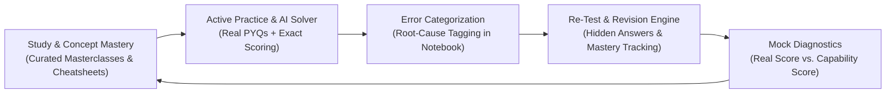

# 🎯 CatPrep (AptiPrep Elite Hub)

> **A focused, local-first preparation workstation, multimodal AI diagnostic solver, and multi-exam preparation hub for the Common Admission Test (CAT), XAT, and GMAT Focus Edition.**

[](https://react.dev/)
[](https://vite.dev/)
[](https://tailwindcss.com/)
[](https://katex.org/)
[](https://firebase.google.com/)
[](https://ai.google.dev/)
[](https://developer.mozilla.org/en-US/docs/Web/API/Window/localStorage)
[](LICENSE)

---

## 📌 Table of Contents

- [Overview](#-overview)
- [The Preparation Philosophy](#-the-preparation-philosophy)
- [Key Features](#-key-features)
  - [1. Daily Tracker & Progress Dashboard](#1-daily-tracker--progress-dashboard)
  - [2. Interactive Multi-Exam Syllabus & Video Masterclasses](#2-interactive-multi-exam-syllabus--video-masterclasses)
  - [3. Question Practice with 4-Tier Solutions](#3-question-practice-with-4-tier-solutions)
  - [4. Multimodal AI Question Solver (Gemini 2.5 Flash)](#4-multimodal-ai-question-solver-gemini-25-flash)
  - [5. Mistake Notebook & Interactive Re-Test Engine](#5-mistake-notebook--interactive-re-test-engine)
  - [6. Mock Test Scorecards & Capability Gap Diagnostics](#6-mock-test-scorecards--capability-gap-diagnostics)
  - [7. R-E-S-T Weekly Study Planner](#7-r-e-s-t-weekly-study-planner)
  - [8. Multi-Exam Ecosystem (CAT, XAT & GMAT Focus)](#8-multi-exam-ecosystem-cat-xat--gmat-focus)
  - [9. Google Sign-In & Multi-Device Cloud Sync (Firebase Spark)](#9-google-sign-in--multi-device-cloud-sync-firebase-spark)
  - [10. Local-First Sovereignty & Instant Backup](#10-local-first-sovereignty--instant-backup)
- [Architecture & Modular Component Design](#-architecture--modular-component-design)
- [Exam Structure & Scoring Blueprints](#-exam-structure--scoring-blueprints)
  - [Common Admission Test (CAT)](#common-admission-test-cat)
  - [Xavier Aptitude Test (XAT)](#xavier-aptitude-test-xat)
  - [GMAT Focus Edition](#gmat-focus-edition)
- [Tech Stack](#-tech-stack)
- [Project Directory Structure](#-project-directory-structure)
- [Getting Started](#-getting-started)
  - [Prerequisites](#prerequisites)
  - [Installation & Running](#installation--running)
  - [Environment Variables Setup](#environment-variables-setup)
  - [Available Scripts](#available-scripts)
- [Roadmap](#-roadmap)
- [Contributing & License](#-contributing--license)

---

## 🌟 Overview

A serious management entrance aspirant’s daily preparation fractures across 5–10 disconnected tools: YouTube playlists, spreadsheet trackers, coaching mock test portals, PDF past-year question banks, WhatsApp groups, and paper notebooks. 

**CatPrep** consolidates the three pillars of high-percentile preparation into a single zero-friction feedback loop:
1. **Learn** — Complete topic syllabi, historical question weightages, expandable formula sheets, and curated topic-by-topic YouTube masterclasses.
2. **Practice** — Past year questions (MCQ, 5-option, and TITA) with authentic marking rules, KaTeX-rendered mathematical typography, and tiered explanations.
3. **Analyze** — Root-cause tagging for errors, mock exam diagnostic scorecards, untimed capability gap analysis, and daily velocity tracking.

All user data is stored **local-first** in your browser with zero tracking and full offline readiness. An optional **Google Sign-In + Cloud Firestore sync** powered by Firebase's free Spark tier allows seamless multi-device continuity.

---

## 🧠 The Preparation Philosophy

> **"CAT is an examination of question selection and accuracy, not syllabus completion."**

- **The 45–50% Rule**: Securing a **99th percentile** in CAT historically requires approximately **85–95 marks out of 198 (~45–50% raw score)**. You do not need to attempt every question; you need to solve 10–12 questions per section with 85%+ accuracy.
- **Pareto Principle in Quantitative Aptitude**: ~70% of QA questions consistently emerge from **Arithmetic** and **Algebra**. CatPrep prioritizes high-yield modules so you maximize return on investment (ROI).
- **The Capability Gap**: The difference between your timed mock score and untimed re-attempt score reveals whether your bottlenecks are *conceptual* or *operational* (time pressure, panic, or poor question selection).



---

## 🚀 Key Features

### 1. Daily Tracker & Progress Dashboard
- **Daily Targets**: Set custom daily goals for questions solved and study minutes.
- **Quick Time Logging**: Rapid 1-click log buttons (`+15m`, `+30m`, `+1h`) to log focus sessions effortlessly.
- **Velocity & Burndown**: Live tracking of topics mastered vs. total syllabus with completion forecasting.
- **Study Streak**: Automatic streak tracking across consecutive study days.
- **CAT Countdown Timer**: Real-time days remaining countdown to keep long-term milestones in perspective.

### 2. Interactive Multi-Exam Syllabus & Video Masterclasses
- **Structured Hierarchy**: Section $\rightarrow$ Module $\rightarrow$ Topic $\rightarrow$ Subtopics covering QA (21 topics), DILR (11 topics), and VARC (8 topics) for CAT, plus comprehensive modules for XAT and GMAT Focus.
- **Historical Weightage & Difficulty**: Topic-by-topic question frequency and difficulty rating tags.
- **Formula Cheatsheets**: Expandable high-yield formula summaries, shortcuts, and theorems right within each topic card.
- **Curated Video Masterclasses**: Direct links to top-tier free lectures on YouTube (Rodha, Elites Grid, Ravi Prakash, 2IIM, Takshzila) organized by topic.
- **Progress & Confidence Tracking**: Toggle status (*Not Started*, *In Progress*, *Mastered*, *Revision Due*) and assign 1–5 star confidence ratings.
- **Topic-Level Question Badges**: Live count of available practice questions with direct one-click practice launch.

### 3. Question Practice with 4-Tier Solutions
- **Multi-Exam Question Bank**: 61 authentic questions covering 100% of CAT topics, XAT Decision Making caselets, and GMAT Focus Data Insights.
- **Authentic Scoring Engines**:
  - **CAT / XAT MCQ**: $+3$ for correct, $-1$ for wrong answers.
  - **TITA (Type In The Answer)**: $+3$ for correct, **0 penalty** for wrong answers.
  - **XAT 5-Option**: Accurate negative marking representation.
- **KaTeX LaTeX Engine**: Flawless mathematical typesetting for complex algebraic expressions, fractions, powers, matrices, and geometric formulas.
- **Immediate Feedback**: Correct answers trigger celebratory confetti; incorrect attempts offer immediate bookmarking and root-cause tagging.
- **4-Tier Solution Drawer**:
  1. 💡 **Core Concept**: Fundamental principles, theorems, and definitions.
  2. 📝 **Step-by-Step**: Thorough, structured textbook-level mathematical derivation.
  3. ⚡ **Exam Shortcut**: Rapid elimination techniques, approximations, and option-substitution tricks.
  4. ⚠️ **Trap Alerts**: Pitfalls, unit traps, edge cases, and common test-maker lures.

### 4. Multimodal AI Question Solver (Gemini 2.5 Flash)
- **Zero-Friction Question Ingestion**: Paste mock screenshot directly from your clipboard (`Ctrl+V`), drag-and-drop an image file, or upload from disk.
- **Gemini Vision OCR**: Uses Google's `gemini-2.5-flash` to extract question text, equations, tables, and options automatically.
- **Automated 4-Tier Generation**: Instantly drafts comprehensive explanations across Core Concept, Step-by-Step, Exam Shortcut, and Trap Alerts.
- **Auto-Topic Classification**: Analyzes question context and maps it to the exact syllabus topic (`TOPIC_CHECK`).
- **Bring-Your-Own-Key Privacy**: Stores your Gemini API key strictly in your local browser storage.

### 5. Mistake Notebook & Interactive Re-Test Engine
- **Automatic Error Logging**: Every incorrectly answered question or bookmarked item is automatically indexed.
- **Root-Cause Error Classification**:
  - 🧠 *Concept Gap* (Theory or formula unknown)
  - ✏️ *Calculation Slip* (Math or arithmetic slip under pressure)
  - 👓 *Misread Question* (Overlooked constraints or units)
  - ⏰ *Time Panic* (Rushed through the problem)
  - 📜 *Formula Forgotten* (Knew the approach but forgot the exact formula)
- **Personal Reflection Journal**: Record takeaways, notes, and personal observations on each error.
- **Interactive Re-Test Mode**: Re-attempt saved mistakes with answers hidden, instant re-evaluation, confetti animations, and mastery progression badges.

### 6. Mock Test Scorecards & Capability Gap Diagnostics
- **Test Series Support**: Log mocks from major providers including **IMS SimCAT**, **TIME AIMCAT**, **Career Launcher CL Prime**, **Cracku**, or custom tests.
- **Section-Wise Breakdown**: Detailed tracking for VARC, DILR, and QA (Attempted, Correct, Incorrect MCQ, Incorrect TITA, Accuracy %, Net Score).
- **Capability Score & Panic Delta**:
  - **Capability Score**: Untimed re-attempt score on the same mock.
  - **Panic Delta**: Difference between Capability Score and Timed Score — reveals marks lost to time pressure and anxiety vs. concept gaps.
- **Percentile Estimator & Trend Analysis**: Visual indicators of scoring trajectory across test series.

### 7. R-E-S-T Weekly Study Planner
- **R-E-S-T Framework**: Pre-configured with coderdevang's proven study strategy:
  - 🔄 **Revise**: Formula sheets, vocabulary flashcards, and concept notes.
  - 🚀 **Enhance**: Targeted practice on weak topics and new concept masterclasses.
  - 🎯 **Strategize**: Sectional test drills, mock error analysis, and question selection rules.
  - 📝 **Test**: Full-length proctored mock exams and time-boxed simulation.
- **Interactive Daily Checklist**: Add, delete, and check off daily study tasks with section tags (QA, DILR, VARC, Mocks).
- **Study Metrics**: Live completion rate %, study minutes logged, and weekly task burndown.

### 8. Multi-Exam Ecosystem (CAT, XAT & GMAT Focus)
- **Common Admission Test (CAT)**: Complete 40-topic QA, DILR, and VARC schemas with video links and cheatsheets.
- **Xavier Aptitude Test (XAT)**:
  - Decision Making (ethical dilemmas, stakeholder trade-offs, managerial caselets).
  - Verbal and Logical Ability (critical reasoning, poem comprehension).
  - Quantitative Ability & Data Interpretation.
  - General Knowledge modules.
- **GMAT Focus Edition**:
  - Quantitative Reasoning (Problem Solving).
  - Verbal Reasoning (Critical Reasoning & Reading Comprehension).
  - Data Insights (Data Sufficiency with 12-second AD/BCE grid method, Multi-Source Reasoning, Two-Part Analysis, Tables & Graphs).

### 9. Google Sign-In & Multi-Device Cloud Sync (Firebase Spark)
- **100% Free Tier (Firebase Spark)**: Uses Google Firebase Authentication and Cloud Firestore within the permanent free limits.
- **One-Click Google Sign-In**: Authenticate using your Google account with pop-up authentication.
- **Bi-directional Cloud Sync**: Push local study progress to Firestore or pull cloud progress to your current device.
- **Safe Guest / Offline Fallback**: Zero forced login. If no Firebase keys are configured, CatPrep functions flawlessly in local guest mode.
- **Setup Guidance Modal**: Built-in interactive setup assistant (`FirebaseSetupModal`) with 1-click template copying for `.env.local`.

### 10. Local-First Sovereignty & Instant Backup
- **Zero Lock-In**: All progress, mistake logs, study sessions, and mock scores are kept in browser `localStorage`.
- **1-Click Backup Export**: Download your complete study history as a structured `.json` file at any time.
- **1-Click Restore**: Seamlessly import your data on any device or browser to restore state without data loss.

---

## 🏗️ Architecture & Modular Component Design

CatPrep is architected with a **fully component-wise, modular, and extensible design**. Each major domain encapsulates its presentation, business logic, and UI elements into dedicated feature directories under `src/components/`:

```
src/components/
├── common/                              # Reusable cross-cutting UI primitives
│   ├── Badge.jsx                        # Status & difficulty indicator pills
│   ├── EmptyState.jsx                   # Consistent empty-state displays
│   └── ProgressBar.jsx                  # Animated progress bars
│
├── dashboard/                           # Daily Tracker & Velocity domain
│   ├── ExamHeroBanner.jsx               # Header banner & CAT countdown timer
│   ├── DailyMetricsGrid.jsx             # 3-column metric cards container
│   ├── QuestionsMetricCard.jsx          # Questions solved vs target
│   ├── TimeSpentMetricCard.jsx          # Study time invested + quick logging (+15m, +30m, +1h)
│   ├── AccuracyMetricCard.jsx           # Daily accuracy % and target editor toggle
│   ├── DailyTargetEditor.jsx            # Inline target customization form
│   ├── SyllabusBurndownCard.jsx         # Master burndown progress & section breakdown
│   ├── TopicsStatsGrid.jsx              # Topic mastery statistics grid
│   ├── SectionProgressRow.jsx           # Individual section progress row
│   └── VelocityForecastCard.jsx         # Remaining hours, completion forecast & CTA
│
├── planner/                             # Weekly Study Planner (R-E-S-T)
│   ├── plannerConstants.js              # DEFAULT_REST_PLAN, badge helpers & pillar metadata
│   ├── PlannerHeaderBanner.jsx          # Header, task meter, study time meter, reset
│   ├── PillarFilterCards.jsx            # Interactive Revise-Enhance-Strategize-Test filter cards
│   ├── PlannerControls.jsx              # Day selection pills + section filter dropdown
│   ├── PlannerTaskItem.jsx              # Task row with checkbox, badges, minutes & delete
│   ├── DayScheduleCard.jsx              # Day card with theme, progress bar, complete-all
│   └── AddTaskModal.jsx                 # Custom scheduled task creator dialog
│
├── syllabus/                            # Syllabus & Weightage domain
│   ├── syllabusHelpers.js               # Topic status badge styling helper
│   ├── SyllabusHeader.jsx               # Header banner & search input
│   ├── SectionTabs.jsx                  # Section tabs (QA, DILR, VARC) with PYQ count badges
│   ├── StatusFilterPills.jsx            # Filter buttons (All, Mastered, In Progress, Not Started)
│   ├── ModuleCard.jsx                   # Module grouping card with study effort hours
│   ├── TopicRow.jsx                     # Topic row (confidence stars, status dropdown, quick practice)
│   ├── TopicDetailsDrawer.jsx           # Expandable cheatsheet, subtopics & study hour logger
│   └── CuratedVideoItem.jsx             # Curated YouTube lecture masterclass cards
│
├── practice/                            # PYQs & Solutions domain
│   ├── PracticeFiltersHeader.jsx        # 5-filter control bar (Section, Difficulty, Status, Year)
│   ├── QuestionCard.jsx                 # Full question container with KaTeX & solutions
│   ├── QuestionOptions.jsx              # MCQ options list with post-submission highlights
│   ├── QuestionTitaInput.jsx            # Numerical input field for TITA questions
│   ├── QuestionActionFooter.jsx         # Submit button, marks breakdown (+3/-1/0) & re-attempt
│   ├── SolutionDrawer.jsx               # 4-tier solution drawer (Step/Shortcut/Concept/Traps)
│   ├── ScreenshotDropzone.jsx           # Drag-and-drop & clipboard screenshot upload area
│   ├── GeminiAutoSolveSection.jsx       # Gemini AI Vision OCR & 4-tier solution trigger
│   └── AddQuestionModal.jsx             # Custom question creation & screenshot OCR modal
│
├── notebook/                            # Mistake & Revision Notebook domain
│   ├── notebookConstants.js             # MISTAKE_REASONS root-cause taxonomy
│   ├── NotebookHeader.jsx               # Counters, Start Drill CTA & root-cause filter pills
│   ├── NotebookQuestionHeader.jsx       # Exam slot badge, re-test status, root-cause tag
│   ├── InlineRetestArea.jsx             # Active re-test mode with answers hidden & evaluation
│   ├── NotebookSolutionViewer.jsx       # Tabbed solution viewer (Step, Shortcut, Concept)
│   ├── MistakeReflectionNotes.jsx       # Personal mistake reflection view & editor
│   └── NotebookQuestionCard.jsx         # Combined mistake card orchestrator
│
├── mocks/                               # Mock Scorecard domain
│   ├── mocksHelper.js                   # calcSectionScore & percentile estimator
│   ├── MockScorecardHeader.jsx          # Header with Log Mock Score CTA
│   ├── PanicDeltaInsightCard.jsx        # Explainer for Untimed Capability & Panic Delta
│   ├── SectionScoreCard.jsx             # Section-level score badges (VARC, DILR, QA)
│   ├── MockReportCard.jsx               # Logged test card with panic delta summary
│   └── LogMockModal.jsx                 # Scorecard logger with real-time net score preview
│
├── resources/                           # Resources & Knowledge Repository domain
│   ├── ResourcesHeader.jsx              # Resources title and description
│   ├── ScorePercentileTable.jsx         # Score vs Percentile cutoffs (99.5%, 99%, 95%, 90%)
│   ├── PastPapersRepository.jsx         # 2IIM, IIM official portal, Cracku past paper links
│   ├── VideoMasterclassesList.jsx       # Elites Grid, Rodha, Bodhee Prep, Aeon recommendations
│   └── ExamExtensibilityCards.jsx       # Architecture roadmap for XAT, GMAT, GRE, GATE
│
├── header/                              # Global Navigation & Top Bar domain
│   ├── BrandLogo.jsx                    # AptiPrep branding & 99%ile badge
│   ├── ExamSelector.jsx                 # Target exam switcher
│   ├── QuickStatsBar.jsx                # Daily target progress bar & streak counter
│   ├── DataActions.jsx                  # AI settings, export JSON, restore JSON
│   ├── GoogleSignInButton.jsx           # Google OAuth button with spinner
│   ├── UserProfileDropdown.jsx          # Avatar, sync status, and account dropdown
│   └── NavigationTabs.jsx               # 7 primary navigation view tabs
│
├── settings/                            # AI Settings domain
│   ├── FeatureExplainer.jsx             # Vision OCR & 4-tier solution explainer
│   └── ApiKeyForm.jsx                   # Password toggle, key verification & storage
│
└── firebase/                            # Cloud Auth Setup domain
    ├── SetupStepItem.jsx                # Numbered guide step cards
    └── EnvTemplateBlock.jsx             # One-click copyable environment template
```

---

## 📊 Exam Structure & Scoring Blueprints

### Common Admission Test (CAT)

| Section | Questions | Duration | Pattern | Marking Scheme | 99%ile Benchmark (Approx) |
| :--- | :---: | :---: | :--- | :--- | :--- |
| **VARC** (Verbal Ability & Reading Comprehension) | 24 | 40 mins | 16 RC (4 passages), 8 VA | $+3$ correct, $-1$ wrong MCQ, $0$ TITA | $\sim 38 - 42$ marks ($\sim 14$ net correct) |
| **DILR** (Data Interpretation & Logical Reasoning) | 20–22 | 40 mins | 4–5 sets (4–5 questions each) | $+3$ correct, $-1$ wrong MCQ, $0$ TITA | $\sim 28 - 32$ marks ($\sim 2 - 2.5$ full sets) |
| **QA** (Quantitative Aptitude) | 22 | 40 mins | Arithmetic, Algebra, Geometry, Numbers, Modern Math | $+3$ correct, $-1$ wrong MCQ, $0$ TITA | $\sim 32 - 36$ marks ($\sim 11 - 12$ net correct) |
| **Total** | **66** | **120 mins** | **$\sim 48$ MCQ, $\sim 18$ TITA** | **Total Marks: 198** | **$\sim 85 - 95$ marks ($\sim 45 - 50\%$ raw score)** |

### Xavier Aptitude Test (XAT)

| Section | Questions | Duration | Focus Areas | Marking Scheme |
| :--- | :---: | :---: | :--- | :--- |
| **Decision Making (DM)** | 21–22 | ~50 mins | Managerial ethics, business dilemmas, stakeholder conflicts | $+1.0$ correct, $-0.25$ wrong |
| **Verbal & Logical Ability (VALA)** | 26 | ~55 mins | Critical reasoning, poem comprehension, RC passages | $+1.0$ correct, $-0.25$ wrong |
| **QA & DI** | 28 | ~65 mins | Advanced arithmetic, algebra, complex data sets | $+1.0$ correct, $-0.25$ wrong |
| **General Knowledge & Essay** | 25 Qs + Essay | 30 mins | Current affairs, static GK, analytical essay | No negative marking for GK |

### GMAT Focus Edition

| Section | Questions | Duration | Focus Areas | Scoring Scale |
| :--- | :---: | :---: | :--- | :--- |
| **Quantitative Reasoning** | 21 | 45 mins | Pure problem solving (No geometry) | 60–90 scale |
| **Verbal Reasoning** | 23 | 45 mins | Critical reasoning, reading comprehension (No SC) | 60–90 scale |
| **Data Insights** | 20 | 45 mins | Data Sufficiency, Multi-Source, Two-Part, Tables/Graphs | 60–90 scale |
| **Total Score** | **64** | **135 mins** | Flexible section order; question review & edit | **205–805 scale** |

---

## 🛠️ Tech Stack

- **Core Framework**: [React 19](https://react.dev/) + [Vite 8](https://vite.dev/)
- **Styling**: [Tailwind CSS v4](https://tailwindcss.com/)
- **Typography & Math**: [KaTeX](https://katex.org/) for fast, accessible LaTeX math rendering
- **Icons**: [Lucide React](https://lucide.dev/)
- **Delight & Animations**: [canvas-confetti](https://www.npmjs.com/package/canvas-confetti)
- **Authentication & Cloud Sync**: [Firebase v13](https://firebase.google.com/) (Google Auth & Cloud Firestore)
- **Multimodal AI**: [Google Gemini API](https://ai.google.dev/) (`gemini-2.5-flash`)
- **Code Quality & Linter**: [Oxlint](https://oxc.rs/)

---

## 📁 Project Directory Structure

```text
CatPrep/
├── public/                 # Static assets & web manifest
├── src/
│   ├── assets/             # Brand graphics, icons & logos
│   ├── components/         # Modular feature-driven component architecture
│   │   ├── common/         # Cross-cutting primitives (Badge, EmptyState, ProgressBar)
│   │   ├── dashboard/      # Daily tracker, burndown, velocity & countdown subcomponents
│   │   ├── firebase/       # Cloud sync setup guide & template block
│   │   ├── header/         # Top navbar, exam selector, cloud status, Google auth & tabs
│   │   ├── mocks/          # Scorecard, section breakdown, panic delta & modal
│   │   ├── notebook/       # Mistake notebook, root-cause tags, re-test & reflection
│   │   ├── planner/        # 7-day R-E-S-T study planner, pillars, task items & modal
│   │   ├── practice/       # Practice cards, KaTeX options, 4-tier solution & AI modal
│   │   ├── resources/      # Score vs percentile, official repos, mentors & roadmap
│   │   ├── settings/       # Gemini AI settings & key verification form
│   │   ├── syllabus/       # Syllabus header, section tabs, module cards & video links
│   │   ├── DashboardTracker.jsx   # Dashboard coordinator page
│   │   ├── FirebaseSetupModal.jsx # Firebase setup guide modal
│   │   ├── Header.jsx             # Application header coordinator
│   │   ├── MathText.jsx           # KaTeX parser for inline & display math
│   │   ├── MistakeNotebook.jsx    # Mistake notebook coordinator page
│   │   ├── MockScorecard.jsx      # Mock scorecard coordinator page
│   │   ├── QuestionPractice.jsx   # Practice & solutions coordinator page
│   │   ├── ResourcesGuide.jsx     # Resources guide coordinator page
│   │   ├── SettingsModal.jsx      # Settings modal coordinator
│   │   ├── StudyPlanner.jsx       # Study planner coordinator page
│   │   └── SyllabusManager.jsx    # Syllabus manager coordinator page
│   ├── context/
│   │   └── AuthContext.jsx        # Google Firebase authentication state & login/logout
│   ├── data/
│   │   ├── examsData.js           # Comprehensive CAT, XAT & GMAT syllabus schemas
│   │   └── questionsData.js       # Authentic questions with 4-tier KaTeX solutions
│   ├── utils/
│   │   ├── cloudSync.js           # Bi-directional Firestore sync engine for user state
│   │   ├── firebase.js            # Firebase app, Google Auth, and Firestore initialization
│   │   ├── gemini.js              # Gemini 2.5 Flash multimodal vision & 4-tier solver API
│   │   └── storage.js             # LocalStorage helpers & JSON export/import handlers
│   ├── App.jsx                    # Main application state, tab routing & modal wiring
│   ├── main.jsx                   # Application entry point with AuthProvider wrapper
│   └── index.css                  # Global styles and Tailwind CSS v4 imports
├── .env.example            # Environment variables template for Firebase configuration
├── CAT_PREP_GUIDE.md       # Strategic preparation framework & exam analysis
├── Plan.md                 # Product development and roadmap plan
├── Requirement.md          # Comprehensive PRD & requirements specification
├── package.json            # Project dependencies and build scripts
└── vite.config.js          # Vite configuration
```

---

## 💻 Getting Started

### Prerequisites

Ensure you have [Node.js](https://nodejs.org/) installed:
- Node.js version **20.19+** or **22.12+** recommended
- `npm`, `yarn`, or `pnpm`

### Installation & Running

1. **Clone the repository**:
   ```bash
   git clone https://github.com/sarathithikkatt/CatPrep.git
   cd CatPrep
   ```

2. **Install dependencies**:
   ```bash
   npm install
   ```

3. **Start the local development server**:
   ```bash
   npm run dev
   ```
   Open [http://localhost:5173](http://localhost:5173) in your browser.

### Environment Variables Setup

CatPrep runs 100% locally out-of-the-box in Guest mode. To enable **Google Sign-In & Multi-Device Cloud Sync** or **Gemini Multimodal AI OCR**:

#### 1. Google Firebase (Cloud Sync)
Copy `.env.example` to `.env.local`:
```bash
cp .env.example .env.local
```

Fill in your Firebase keys (from [Firebase Console](https://console.firebase.google.com/) $\rightarrow$ Project Settings $\rightarrow$ Web App):
```env
VITE_FIREBASE_API_KEY=your_api_key_here
VITE_FIREBASE_AUTH_DOMAIN=your_project_id.firebaseapp.com
VITE_FIREBASE_PROJECT_ID=your_project_id
VITE_FIREBASE_STORAGE_BUCKET=your_project_id.firebasestorage.app
VITE_FIREBASE_MESSAGING_SENDER_ID=your_messaging_sender_id
VITE_FIREBASE_APP_ID=your_app_id
VITE_FIREBASE_MEASUREMENT_ID=your_measurement_id_here
```

#### 2. Gemini Multimodal AI (Image OCR & Solver)
You can enter your Google Gemini API key directly in the application UI:
- Click the **Sparkles icon (✨)** in the top header.
- Paste your Gemini API key from [Google AI Studio](https://aistudio.google.com/app/apikey).
- Click **Test Key & Save Settings**. The key is stored locally in your browser.

### Available Scripts

| Command | Purpose |
| :--- | :--- |
| `npm run dev` | Starts the Vite development server with Hot Module Replacement (HMR). |
| `npm run build` | Compiles and bundles production-ready assets into `/dist`. |
| `npm run preview` | Locally serves the production build for testing. |
| `npm run lint` | Runs Oxlint to check code quality and detect lint errors quickly. |

---

## 🗺️ Roadmap

- [x] **Core Dashboard**: Daily questions and study-time target tracker with velocity forecast.
- [x] **Full CAT Syllabus**: 40+ topics across QA, DILR, and VARC with weightage and difficulty metrics.
- [x] **Curated Video Lectures**: Topic-wise embedded masterclass YouTube links (40/40 topics).
- [x] **Mock Test Scorecards**: Multi-platform mock logging (SimCAT, AIMCAT, CL Prime) and capability gap analysis.
- [x] **Authentic Marking**: Correct $+3 / -1$ MCQ and $+3 / 0$ TITA scoring.
- [x] **Mistake Notebook**: Automatic error capture with 5 root-cause tags.
- [x] **Exam Countdown**: Live countdown timer for CAT exam.
- [x] **4-Tier Solution Drawer**: Core Concept, Step-by-Step, Exam Shortcut, and Trap Alerts.
- [x] **Interactive Re-Test Mode**: Hidden-answer revision engine in Mistake Notebook and Practice arena.
- [x] **Weekly Study Planner**: 7-day R-E-S-T (Revise, Enhance, Strategize, Test) task scheduler.
- [x] **Multi-Exam Expansion**: Full syllabus and authentic questions for XAT (Decision Making) and GMAT Focus Edition (Data Insights).
- [x] **Multimodal AI Solver**: Gemini 2.5 Flash vision OCR, image paste/upload, and automatic 4-tier solution generation.
- [x] **Firebase Cloud Sync & Google Auth**: Free Spark tier Google OAuth and bi-directional Firestore cloud synchronization.
- [x] **Component-Wise Modular Architecture**: Every page decomposed into clean, extensible feature directories.
- [ ] **Expanded PYQ Bank**: Continuous scaling of past year questions towards the 200+ milestone.
- [ ] **Offline PWA Service Worker**: Installable desktop/mobile progressive web app.

---

## 📄 Contributing & License

Contributions, feedback, and pull requests are warmly welcome! Whether it is adding more past year questions, refining 4-tier solution explanations, or contributing exam strategies:

1. Fork the Project
2. Create your Feature Branch (`git checkout -b feature/AmazingFeature`)
3. Commit your Changes (`git commit -m 'feat: add AmazingFeature'`)
4. Push to the Branch (`git push origin feature/AmazingFeature`)
5. Open a Pull Request

Distributed under the **MIT License**. See `LICENSE` for more information.

---

<p align="center">
  <b>Built for serious CAT, XAT, and GMAT aspirants aiming for top percentiles. Selection & Accuracy &gt; Blind Completion.</b>
</p>
