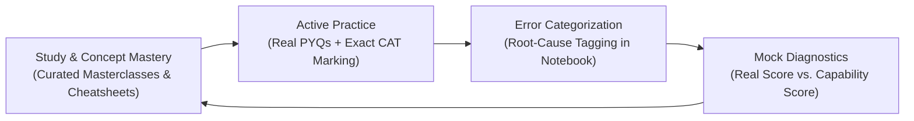

# 🎯 CatPrep (AptiPrep Elite Hub)

> **A focused, local-first preparation workspace and diagnostic engine for the Common Admission Test (CAT) and competitive management entrance exams.**

[](https://react.dev/)
[](https://vite.dev/)
[](https://tailwindcss.com/)
[](https://katex.org/)
[](https://developer.mozilla.org/en-US/docs/Web/API/Window/localStorage)
[](LICENSE)

---

## 📌 Table of Contents

- [Overview](#-overview)
- [The CAT Preparation Philosophy](#-the-cat-preparation-philosophy)
- [Key Features](#-key-features)
  - [1. Daily Tracker & Progress Dashboard](#1-daily-tracker--progress-dashboard)
  - [2. Interactive Syllabus & Video Masterclasses](#2-interactive-syllabus--video-masterclasses)
  - [3. Question Practice with 4-Tier Solutions](#3-question-practice-with-4-tier-solutions)
  - [4. Mistake Notebook & Root-Cause Error Analysis](#4-mistake-notebook--root-cause-error-analysis)
  - [5. Mock Test Scorecards & Capability Analysis](#5-mock-test-scorecards--capability-analysis)
  - [6. Resources & Score vs Percentile Benchmarks](#6-resources--score-vs-percentile-benchmarks)
  - [7. Local-First Privacy & Backup](#7-local-first-privacy--backup)
- [CAT Exam Structure & Scoring Blueprint](#-cat-exam-structure--scoring-blueprint)
- [Tech Stack](#-tech-stack)
- [Project Directory Structure](#-project-directory-structure)
- [Getting Started](#-getting-started)
  - [Prerequisites](#prerequisites)
  - [Installation & Running](#installation--running)
  - [Scripts](#scripts)
- [Roadmap](#-roadmap)
- [Contributing & License](#-contributing--license)

---

## 🌟 Overview

A serious CAT aspirant’s preparation typically fractures across 5–10 disconnected tools: YouTube playlists, spreadsheet trackers, coaching mock portals, PDF question banks, WhatsApp notes, and paper notebooks. 

**CatPrep** consolidates the three pillars of preparation into a unified, zero-friction feedback loop:
1. **Learn** — Syllabus navigation, historical topic weightages, expandable formula sheets, and embedded topic-wise video lectures.
2. **Practice** — Past year CAT questions (MCQ & TITA) with exact marking rules, KaTeX-rendered equations, and tiered explanations.
3. **Analyze** — Root-cause tagging for errors, mock exam diagnostic scorecards, untimed capability gap analysis, and daily velocity tracking.

All data is stored **100% locally in your browser**—no mandatory account creation, zero tracking, and instant offline usability with 1-click JSON backup export/import.

---

## 🧠 The CAT Preparation Philosophy

> **"CAT is an examination of question selection and accuracy, not syllabus completion."**

- **The 45–50% Rule**: Securing a **99th percentile** in CAT historically requires approximately **85–95 marks out of 198 (~45–50% raw score)**. You do not need to attempt every question; you need to solve 10–12 questions per section with 85%+ accuracy.
- **Pareto Principle in Quantitative Aptitude**: ~70% of QA questions consistently come from **Arithmetic** and **Algebra**. CatPrep prioritizes high-yield modules so you maximize return on investment (ROI).
- **The Capability Gap**: The difference between your timed mock score and untimed re-attempt score reveals whether your bottlenecks are *conceptual* or *operational* (time pressure, panic, or poor question selection).



---

## 🚀 Key Features

### 1. Daily Tracker & Progress Dashboard
- **Daily Targets**: Set custom daily goals for questions solved and study minutes.
- **Quick Time Logging**: Rapid 1-click log buttons (`+15m`, `+30m`, `+1h`) to log focus sessions effortlessly.
- **Velocity & Burndown**: Live tracking of topics mastered vs. total syllabus with completion forecasting.
- **Study Streak**: Automatic streak tracking across consecutive study days.
- **CAT Countdown Timer**: Real-time days remaining countdown to keep long-term milestones in perspective.

### 2. Interactive Syllabus & Video Masterclasses
- **Structured Hierarchy**: Section $\rightarrow$ Module $\rightarrow$ Topic $\rightarrow$ Subtopics covering QA (21 topics), DILR (11 topics), and VARC (8 topics).
- **Historical Weightage & Difficulty**: Topic-by-topic CAT question frequency and difficulty rating tags.
- **Formula Cheatsheets**: Expandable high-yield formula summaries and theorems right within each topic card.
- **Curated Video Masterclasses**: Direct links to top-tier free lectures on YouTube (Rodha, Elites Grid, Ravi Prakash, 2IIM) organized by topic.
- **Progress & Confidence Tracking**: Toggle status (*Not Started*, *In Progress*, *Mastered*, *Revision Due*) and assign 1–5 star confidence ratings.
- **Seamless Practice Jump**: Jump straight into topic-filtered practice questions with one click.

### 3. Question Practice with 4-Tier Solutions
- **Real CAT PYQ Bank**: Filter questions by Section, Topic, Year, Slot, Difficulty, and Attempt status.
- **Authentic Scoring**:
  - **MCQ**: $+3$ for correct, $-1$ for wrong answers.
  - **TITA (Type In The Answer)**: $+3$ for correct, **0 penalty** for wrong answers.
- **KaTeX LaTeX Engine**: Flawless mathematical typesetting for complex algebraic expressions, fractions, powers, and geometric formulas.
- **Immediate Feedback**: Correct answers trigger instant celebratory animations; incorrect attempts offer immediate bookmarking.
- **4-Tier Solution Drawer**:
  1. 💡 **Core Concept**: Fundamental principles and formulas needed.
  2. 📝 **Step-by-Step**: Thorough, structured standard textbook derivation.
  3. ⚡ **Exam Shortcut**: Fast elimination techniques, approximations, and option-substitution tricks.
  4. ⚠️ **Trap Alerts**: Pitfalls, misinterpretations, and common test-maker traps.

### 4. Mistake Notebook & Root-Cause Error Analysis
- **Automatic Collection**: Every incorrectly answered question or manually bookmarked item is cataloged automatically.
- **Root-Cause Error Classification**:
  - 🧠 *Concept Gap* (Theory or formula unknown)
  - ✏️ *Calculation Slip* (Math error under pressure)
  - 👓 *Misread Question* (Overlooked constraints or units)
  - ⏰ *Time Panic* (Rushed through the problem)
  - 📜 *Formula Forgotten* (Knew the approach but forgot the exact formula)
- **Personal Reflection Journal**: Add personal notes and takeaways to each logged mistake.
- **Instant Shortcut Reminders**: Review the exam shortcut directly inside the notebook entry to reinforce rapid problem solving.

### 5. Mock Test Scorecards & Capability Analysis
- **Test Series Support**: Log mocks from major providers including **IMS SimCAT**, **TIME AIMCAT**, **Career Launcher CL Prime**, **Cracku**, or custom mocks.
- **Section-Wise Breakdown**: Detailed tracking for VARC, DILR, and QA (Attempted, Correct, Incorrect MCQ, Incorrect TITA, Accuracy %, Net Score).
- **Capability Score Tracking**: Log your untimed re-attempt score to diagnose the gap between your conceptual knowledge and timed execution.
- **Performance Diagnostics**: Automatically computes section efficiency, attempt rate, accuracy percentage, and test takeaways.

### 6. Resources & Score vs Percentile Benchmarks
- **Score vs. Percentile Mapping**: Historical score tables for 99.5+, 99.0+, 95.0+, and 90.0+ percentiles across CAT cycles.
- **Target Strategy Matrix**: Minimum net questions required per section to hit target percentiles.
- **Curated Free Resources**: Links to official IIM portals, verified free PYQ databases, and recommended educator playlists.

### 7. Local-First Privacy & Backup
- **Zero Cloud Lock-in**: All progress, mistake logs, study sessions, and mock scores are kept in browser `localStorage`.
- **1-Click Backup Export**: Download your complete study history as a structured `.json` file at any time.
- **1-Click Restore**: Seamlessly import your data on any device or browser to restore state without data loss.

---

## 📊 CAT Exam Structure & Scoring Blueprint

| Section | Questions | Duration | Pattern | Marking Scheme | 99%ile Benchmark (Approx) |
| :--- | :---: | :---: | :--- | :--- | :--- |
| **VARC** (Verbal Ability & Reading Comprehension) | 24 | 40 mins | 16 RC (4 passages), 8 VA | $+3$ correct, $-1$ wrong MCQ, $0$ TITA | $\sim 38 - 42$ marks ($\sim 14$ net correct) |
| **DILR** (Data Interpretation & Logical Reasoning) | 20–22 | 40 mins | 4–5 sets (4–5 questions each) | $+3$ correct, $-1$ wrong MCQ, $0$ TITA | $\sim 28 - 32$ marks ($\sim 2 - 2.5$ full sets) |
| **QA** (Quantitative Aptitude) | 22 | 40 mins | Arithmetic, Algebra, Geometry, Numbers, Modern Math | $+3$ correct, $-1$ wrong MCQ, $0$ TITA | $\sim 32 - 36$ marks ($\sim 11 - 12$ net correct) |
| **Total** | **66** | **120 mins** | **$\sim 48$ MCQ, $\sim 18$ TITA** | **Total Marks: 198** | **$\sim 85 - 95$ marks ($\sim 45 - 50\%$ raw score)** |

---

## 🛠️ Tech Stack

- **Core Framework**: [React 19](https://react.dev/) + [Vite 8](https://vite.dev/)
- **Styling**: [Tailwind CSS v4](https://tailwindcss.com/)
- **Typography & Math**: [KaTeX](https://katex.org/) for fast, accessible LaTeX math rendering
- **Icons**: [Lucide React](https://lucide.dev/)
- **Delight & Animations**: [canvas-confetti](https://www.npmjs.com/package/canvas-confetti)
- **Linter**: [Oxlint](https://oxc.rs/)

---

## 📁 Project Directory Structure

```text
CatPrep/
├── public/                 # Static assets
├── src/
│   ├── assets/             # Brand graphics and images
│   ├── components/         # Modular UI components
│   │   ├── DashboardTracker.jsx # Daily tracker, burndown, streak & countdown
│   │   ├── Header.jsx           # Top navbar, exam switcher & data export/import
│   │   ├── MathText.jsx         # KaTeX parser component for inline/display math
│   │   ├── MistakeNotebook.jsx  # Error logging with root-cause categorization
│   │   ├── MockScorecard.jsx    # Mock exam scorecard and capability analyzer
│   │   ├── QuestionPractice.jsx # Interactive practice arena with 4-tier drawer
│   │   ├── ResourcesGuide.jsx   # Score vs percentile guide & educator links
│   │   └── SyllabusManager.jsx  # Interactive topic manager & video lectures
│   ├── data/
│   │   ├── examsData.js         # Comprehensive syllabus & video lecture metadata
│   │   └── questionsData.js     # Past year CAT questions & multi-tier solutions
│   ├── utils/
│   │   └── storage.js           # LocalStorage helpers & JSON export/import handlers
│   ├── App.jsx                  # Main application state and tab routing
│   ├── index.css                # Global styles and Tailwind imports
│   └── main.jsx                 # Application entry point
├── CAT_PREP_GUIDE.md       # Strategic preparation framework & exam analysis
├── Plan.md                 # Product development and roadmap plan
├── Requirement.md          # Comprehensive PRD & requirements specification
├── package.json            # Project dependencies and build scripts
└── vite.config.js          # Vite configuration
```

---

## 💻 Getting Started

### Prerequisites

Ensure you have [Node.js](https://nodejs.org/) installed:
- Node.js version **20.19+** or **22.12+** recommended
- npm, yarn, or pnpm

### Installation & Running

1. **Clone the repository**:
   ```bash
   git clone https://github.com/sarathithikkatt/CatPrep.git
   cd CatPrep
   ```

2. **Install dependencies**:
   ```bash
   npm install
   ```

3. **Start the local development server**:
   ```bash
   npm run dev
   ```
   Open [http://localhost:5173](http://localhost:5173) in your browser to start studying.

### Scripts

| Command | Purpose |
| :--- | :--- |
| `npm run dev` | Starts the Vite development server with Hot Module Replacement (HMR). |
| `npm run build` | Compiles and bundles production-ready assets into `/dist`. |
| `npm run preview` | Locally serves the production build for testing. |
| `npm run lint` | Runs Oxlint to check code quality and detect lint errors quickly. |

---

## 🗺️ Roadmap

- [x] **Core Dashboard**: Daily questions and study-time target tracker with velocity forecast.
- [x] **Full CAT Syllabus**: 40+ topics across QA, DILR, and VARC with weightage and difficulty metrics.
- [x] **Curated Video Lectures**: Topic-wise embedded masterclass YouTube links.
- [x] **Mock Test Scorecards**: Multi-platform mock logging (SimCAT, AIMCAT, CL Prime) and capability gap analysis.
- [x] **Authentic Marking**: Correct $+3 / -1$ MCQ and $+3 / 0$ TITA scoring.
- [x] **Mistake Notebook**: Automatic error capture with 5 root-cause tags.
- [x] **Exam Countdown**: Live countdown timer for CAT.
- [ ] **Expanded PYQ Bank**: Scaling question bank to 200+ past year questions.
- [ ] **Re-test / Revision Mode**: Interactive re-attempt mode for questions saved in the Mistake Notebook.
- [ ] **Daily Study Planner**: Structured multi-week R-E-S-T (Revise, Enhance, Strategize, Test) task scheduler.
- [ ] **Multi-Exam Full Data**: Expanding syllabus and questions for XAT (Decision Making) and GMAT Focus.

---

## 📄 Contributing & License

Contributions, feedback, and pull requests are warmly welcome! Whether it is adding more past year questions, improving solution explanations, or adding new study features:

1. Fork the Project
2. Create your Feature Branch (`git checkout -b feature/AmazingFeature`)
3. Commit your Changes (`git commit -m 'feat: add AmazingFeature'`)
4. Push to the Branch (`git push origin feature/AmazingFeature`)
5. Open a Pull Request

Distributed under the **MIT License**. See `LICENSE` for more information.

---

<p align="center">
  <b>Built for serious CAT aspirants aiming for the 99th percentile. Selection & Accuracy &gt; Blind Completion.</b>
</p>
