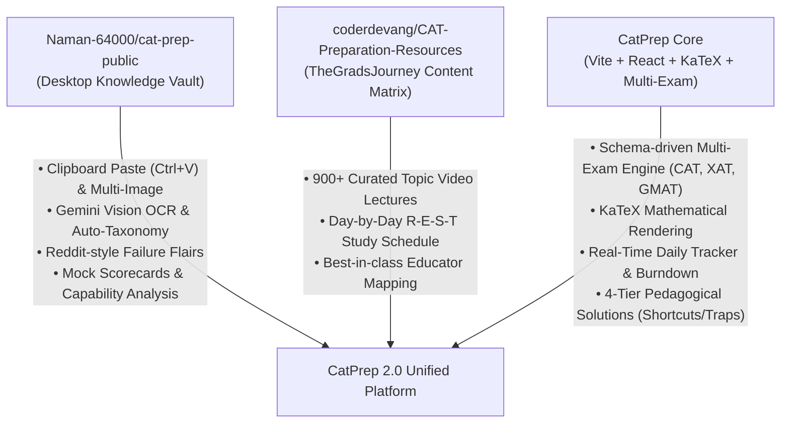
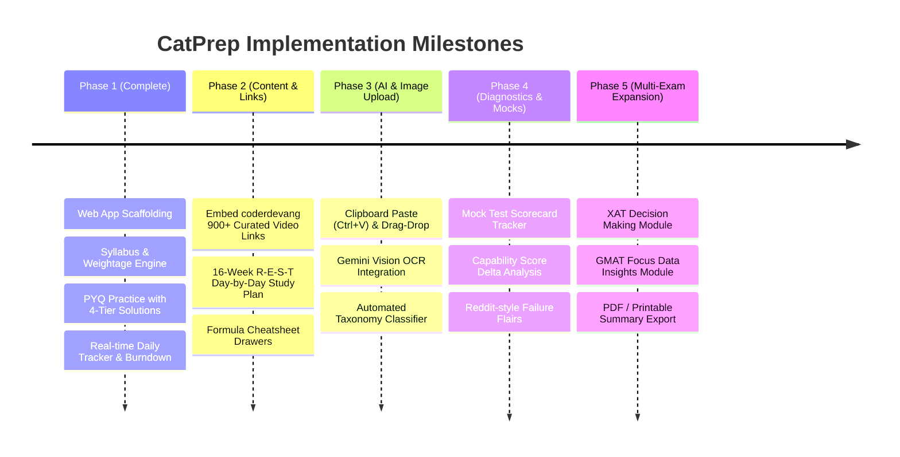

# CatPrep (AptiPrep Hub): Master Product Requirements Document (PRD)

**Project Name**: CatPrep (AptiPrep Elite Hub)  
**Target Examination**: CAT (Common Admission Test) — Scalable to XAT, GMAT Focus, GRE, and GATE  
**Version**: 2.0 (Synthesized Architecture)  
**Status**: Active Specifications  

---

## 1. Executive Summary & Product Vision

### 1.1 Vision Statement
To build the most comprehensive, scientifically engineered, and distraction-free preparation workstation for **CAT** and premier competitive aptitude examinations. CatPrep bridges the gap between **passive content consumption** (lectures/books) and **active cognitive mastery** (timed practice, automated daily tracking, diagnostic error analysis, and AI-powered step-by-step resolution).

### 1.2 Core Guiding Philosophy
> *"CAT is an examination of **selection and accuracy**, not blind completion."*  
A 99th percentile score in CAT requires scoring approximately **45% to 50% net marks** with >85% accuracy. The platform prioritizes high-yield topic prioritization, distractor trap analysis, shortcut techniques, and systematic elimination of candidate error patterns.

---

## 2. Competitive Benchmarking & Feature Scan

This specification synthesizes the strongest architectural patterns and feature sets discovered across benchmark open-source projects:

### Detailed Feature Scan Comparison Matrix

| Capability | `Naman-64000/cat-prep-public` | `coderdevang/CAT-Preparation-Resources` | Current CatPrep Web App | **CatPrep 2.0 (Target Spec)** |
| :--- | :--- | :--- | :--- | :--- |
| **Platform Delivery** | Electron Desktop App (~300MB bundle) | Excel Spreadsheet / Google Sheet | Lightweight Vite React Web App | **Vite React Web App (PWA capable)** |
| **Math Formula Typography** | Basic Markdown formatting | Plain text | KaTeX ($\LaTeX$) Math Engine | **Full KaTeX Math Rendering** |
| **Question Ingestion** | Drag & drop / Clipboard paste (`Ctrl+V`) | Static links | Pre-seeded bank + Manual Form | **Multi-Image Paste (`Ctrl+V`) + Pre-seeded PYQs** |
| **Multi-Image Support** | Up to 6 images (VARC passages & DILR sets) | N/A | Single question per item | **Up to 6 images per set (RC passages, DILR)** |
| **AI Auto-Solving & OCR** | Google Gemini Vision API (`gemini-2.5-flash-lite`) | None | Static solutions | **Gemini Vision OCR + Auto-Classifier** |
| **Topic Taxonomy Mapping** | Automated via prompt parsing | Manual categorization | Manual JSON schema | **Automated AI Taxonomy + Manual Override** |
| **Curated Lecture Links** | None | 903+ links (Rodha, Anastasis, Gejo) | General links | **1-Click Topic $\to$ Top Lecture Player** |
| **Study Calendar** | Sectional To-Do List | Day-by-Day 16-Week R-E-S-T Schedule | Daily target tracker | **Structured R-E-S-T Calendar + Daily To-Do** |
| **Error Diagnostics** | Failure Flairs (*Concept Gap*, *Calc Error*) | None | Mistake Notebook with notes | **Flairs + Reflection Notes + Retest Queue** |
| **Mock Exam Scorecards** | Full & Sectional Mock Reports + Capability score | None | None | **Full Mock Test Scorecard & Capability Gap** |
| **TITA Scoring Logic** | Implemented (0 negative for TITA) | None | +3 / -1 basic | **Accurate CAT Scoring (+3 / -1 MCQ, 0 TITA)** |
| **Multi-Exam Capability** | CAT only | CAT only | CAT, XAT, GMAT Focus | **Schema-driven (CAT, XAT, GMAT, GRE, GATE)** |
| **Data Privacy & Storage** | Local SQLite via Prisma | Local Spreadsheet | LocalStorage + JSON Export/Import | **Local Storage + IndexedDB + JSON Backup** |

---

## 3. Detailed Functional Requirements (FR)

### Module 1: Multi-Exam Core & Hierarchical Syllabus Engine (FR-1)
* **FR-1.1: Multi-Exam Architecture**: System shall support an extensible exam schema (`examsData.js`). Top-level navbar shall allow switching between target examinations (CAT 2025/2026, XAT 2026, GMAT Focus Edition) without code refactoring.
* **FR-1.2: Hierarchical Taxonomy**: Curriculum must follow a four-tier hierarchy:
  $$\text{Exam} \longrightarrow \text{Section} \longrightarrow \text{Module} \longrightarrow \text{Topic} \longrightarrow \text{Subtopics}$$
* **FR-1.3: Topic Metadata & High-Yield Indicators**:
  * Historical Weightage (e.g., *High ~40% ROI*, *Differentiator ~30%*).
  * Difficulty Tier (*Easy-Moderate*, *Moderate*, *Hard*, *Challenging*).
  * Estimated Effort Hours (benchmarked for 99th percentile mastery).
  * Formula Cheatsheet & High-Yield Axiom Summary.
  * Status States: `Not Started` $\to$ `In Progress` $\to$ `Mastered` $\to$ `Revision Due`.
  * User Confidence Rating: Interactive 1 to 5 stars.
* **FR-1.4: 1-Click Curated Video Lecture Player** *(From `coderdevang`)*:
  * Each syllabus topic shall feature direct 1-click launch buttons to verified top educator playlists:
    * *Arithmetic / Algebra*: Ravi Prakash (Rodha) & Raman Tiwari (Formula Book).
    * *DILR*: Anastasis Shankar (Daily DILR / Conundrum Carousel) & Elites Grid (Marathon).
    * *VARC*: Gejo Speaks (Option Traps in RC) & Bodhee Prep (Aeon Essays).

---

### Module 2: Multi-Modal Question Bank & Ingestion Engine (FR-2)
* **FR-2.1: Pre-seeded Authentic Previous Year Questions (PYQs)**:
  * Native bank of official CAT questions (Slots 1, 2, and 3 from 2017 to 2024).
  * Supported Question Formats:
    * **MCQ** (4 answer choices, single correct, +3 / -1 marks).
    * **TITA** (Type In The Answer / Non-MCQ, +3 marks, **0 negative marks**).
* **FR-2.2: Screenshot & Clipboard Ingestion (`Ctrl+V`)** *(From `Naman-64000`)*:
  * Users can paste screenshots directly from their clipboard (`Ctrl+V` / `Cmd+V`) or drag-and-drop image files anywhere on the upload zone.
  * Multi-Image grouping:
    * **VARC**: Up to 6 images (accommodates multi-paragraph RC passages + multiple subsequent questions).
    * **DILR**: Up to 6 images (accommodates problem narrative + multi-tier charts, tables, and sub-questions).
    * **Quants**: Single image upload.
* **FR-2.3: AI Vision OCR & Automated Taxonomy Solver** *(From `Naman-64000`)*:
  * Integration with Google Gemini Vision API (`gemini-2.5-flash-lite` or user-supplied API key).
  * Auto-Extraction: Transcribes question text, diagrams, and options.
  * Auto-Taxonomy Classifier: Employs strict prompt guidelines to tag questions into exact subtopics (`Arithmetic › Percentages`, `LR › Tournaments`, `RC › Philosophy`).
  * Cross-Section Auto-Correction: Alerts the user if an LRDI set was uploaded into the Quants section by mistake.
  * Generation Safeguards: Maximum 2 generation attempts per question to prevent API overuse.

---

### Module 3: Pedagogical Solutions & Active Practice Engine (FR-3)
* **FR-3.1: Active Practice Mode**:
  * Unrevealed question statements allowing the user to select an option or input TITA values.
  * Immediate evaluation with visual feedback (Green check + celebration confetti on correct; red cross with correct option highlight on incorrect).
* **FR-3.2: 4-Tier Cognitive Solution Drawer**:
  Every question solution must provide four distinct perspectives:
  1. **Core Concept & Formula Foundation**: The theoretical rule, mathematical identity, or grammatical axiom governing the problem.
  2. **Detailed Step-by-Step Derivation**: Comprehensive algebraic or deductive proof.
  3. **⚡ Exam Pro Shortcut**: High-speed exam techniques (Option elimination, extreme value substitution, symmetry, bounding, parity checks).
  4. **⚠️ Distractor & Trap Alerts**: Detailed explanation of why typical incorrect choices were designed to trap hasty test-takers.
* **FR-3.3: Mathematical Typography**:
  * 100% KaTeX integration for clean rendering of fractions ($\frac{a}{b}$), exponents ($x^2$), roots ($\sqrt{x}$), logarithms ($\log_b a$), summations ($\sum$), and set logic ($\cap, \cup$).

---

### Module 4: Daily Tracker, Burndown & Velocity Forecaster (FR-4)
* **FR-4.1: Daily Target Setting**:
  * Customizable target: Questions per day (default: 25) and Study Minutes per day (default: 120 mins).
* **FR-4.2: Today's Done vs. Remaining**:
  * Real-time progress bar of questions completed today vs daily goal.
  * Time Invested tracker with quick-log buttons (`+15m`, `+30m`, `+1h`) and manual duration input.
  * Live Daily Accuracy:
    $$\text{Daily Accuracy (\%)} = \left(\frac{\text{Correct Questions Today}}{\text{Total Questions Solved Today}}\right) \times 100$$
* **FR-4.3: Syllabus Burndown & Velocity Forecasting**:
  * Overall syllabus completion percentage across all sections.
  * Segmented progress bars for QA, DILR, and VARC.
  * Projected Days Remaining calculation:
    $$\text{Days Remaining} = \frac{\text{Total Curriculum Remaining Hours} \times 60}{\text{Current Daily Study Pace (Mins/Day)}}$$
* **FR-4.4: Streak Consistency Engine**:
  * Consecutive study days counter with flame streak indicator.

---

### Module 5: Mistake Notebook & Failure Flairs (FR-5)
* **FR-5.1: Reddit-Style Error Flairs** *(From `Naman-64000`)*:
  * Every incorrect or bookmarked question can be categorized by root cause:
    * `Concept Gap`: Fundamental rule or identity unknown.
    * `Formula Forgotten`: Formula memorized incompletely.
    * `Calculation Slip`: Arithmetic or algebraic error despite correct approach.
    * `Misread Statement`: Overlooked constraint or misread units.
    * `Time Pressure / Panic`: Rushed attempt or wild guess under clock stress.
    * `Trap Choice`: Fell for an intentional distractor.
    * `Set Selection Error`: (DILR) Invested time in an intractable puzzle set.
* **FR-5.2: Personal Reflection Logs**:
  * Markdown note box per error card for personal reflections (e.g., *"Check if question asks for radius or diameter"*).
* **FR-5.3: Revision Queue**:
  * Filter questions by failure flair.
  * "Re-test" button to re-attempt questions in blind revision mode.

---

### Module 6: Mock Exam Scorecards & Capability Analysis (FR-6) *(From `Naman-64000`)*
* **FR-6.1: Mock Test Scorecard Logger**:
  * Log sectional and full-length mock exams (IMS SimCAT, TIME AIMCAT, CL PRIME, Cracku).
  * Input table for VARC, DILR, and QA: Total Questions, Attempted, Correct, Incorrect, and **TITA Incorrect**.
  * Official CAT Score Formula Calculation:
    $$\text{Net Score} = (\text{Correct} \times 3) - \left[(\text{Incorrect} - \text{TITA Incorrect}) \times 1\right]$$
* **FR-6.2: Capability Score Comparison**:
  * Allows logging an untimed "Capability Score" for the same mock test.
  * Visualizes the **"Panic Delta"**: difference between what the candidate scores under the 40-minute clock vs what they score when granted time to reason through every question.
* **FR-6.3: Target Countdown Ring**:
  * Visual countdown ring to CAT Exam Date (November 29, 2026).
  * Progress ring dynamically tracks elapsed preparation days versus remaining days.

---

### Module 7: Day-by-Day R-E-S-T Study Planner & To-Do Lists (FR-7) *(From `coderdevang` & `Naman-64000`)*
* **FR-7.1: 16-Week Day-by-Day Study Schedule**:
  * Integrated study roadmap following the **R-E-S-T framework**:
    * **R** - *Revise*: Consolidate prior week's formulas.
    * **E** - *Enhance*: Deep-dive foundational video lectures.
    * **S** - *Strategize*: Attempt timed sectional drills.
    * **T** - *Test*: Sectional or full-length mock exam.
* **FR-7.2: Sectional Daily To-Do Lists**:
  * Daily actionable items divided by section (QA, DILR, VARC).
  * Time-slot scheduling and completion checkboxes.

---

### Module 8: Data Privacy, Local Persistence & Backup (FR-8)
* **FR-8.1: Zero Cloud / Local-First Privacy**:
  * 100% of user study logs, attempts, question bookmarks, and notes are stored locally (LocalStorage / IndexedDB). No external servers track user progress.
* **FR-8.2: Export & Import JSON Backup**:
  * One-click JSON backup export (`catprep_backup_YYYY-MM-DD.json`).
  * One-click JSON restore to transfer progress between devices seamlessly.

---

## 4. Non-Functional Requirements (NFR)

* **NFR-1: Performance & Startup**: Initial page load under 1.2 seconds; zero runtime lag during formula rendering.
* **NFR-2: Offline Capability**: Web app must function completely offline after first load, leveraging service workers and browser caches.
* **NFR-3: Responsive Design**: Fully responsive across desktops (primary exam layout), laptops, tablets, and smartphones.
* **NFR-4: Browser Compatibility**: Modern Chromium browsers, Firefox, Safari, and Edge.
* **NFR-5: Modular Code Architecture**: Clean separation of Data (`src/data/`), Utilities (`src/utils/`), and Components (`src/components/`).

---

## 5. Phased Implementation Roadmap

---

*Authored for the CatPrep Workspace repository at `d:\Dev\CatPrep`.*
